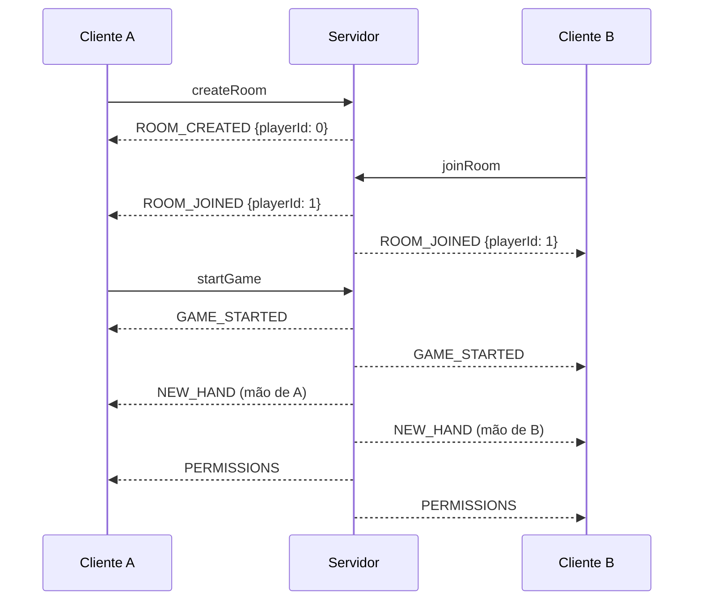

# Protocolo de Eventos — Cliente ⇄ Servidor

Referência para o frontend de todos os eventos que o cliente pode **enviar** e **receber** via WebSocket.

> [!TIP]
> **Arquivo TypeScript para o Frontend:**
> O arquivo [`src/game-logic/shared/events.map.ts`](file:///home/eumesmo/Documents/personals/card-game-deno/card-game/src/game-logic/shared/events.map.ts) reúne **100% dos tipos TypeScript, enums, payloads e envelopes** (tanto de entrada quanto de saída) em um arquivo único sem dependências externas de backend. Você pode copiá-lo diretamente para a pasta `src/types` ou `src/network` do seu frontend.

Os schemas de validação Zod originais no backend ficam divididos em:

- `src/network/external-payloads.ts` → eventos **EXTERNAL** (sala, conexão, erros)
- `src/game-logic/shared/events/client/client-payloads.ts` → eventos **GAME** enviados pelo cliente
- `src/game-logic/shared/events/server/server-payloads.ts` → eventos **GAME** enviados pelo servidor

---

## 1. Conexão e envelope

- **URL:** `ws://<host>:9000/ws`
- Toda mensagem (nos dois sentidos) é um JSON com este envelope:

```ts
type EventType = "GAME" | "EXTERNAL";

interface EventNetwork<T = unknown> {
  type: EventType; // GAME = jogada da engine | EXTERNAL = sala/conexão
  name: string; // nome do evento (ver tabelas abaixo)
  sendedBy: number; // id do jogador. Cliente→servidor: seu playerId (default -1).
  // Servidor→cliente: id de quem causou o evento, ou -1 se foi o servidor
  roomName: string; // OBRIGATÓRIO, 5 a 10 caracteres
  data: T;
}
```

> [!IMPORTANT]
> **Eventos `GAME` enviados pelo cliente precisam de um `data` aninhado.** O servidor faz
> `gameEventSchema.parse(event.data)` e usa `event.data.data` como payload:
>
> ```json
> {
>   "type": "GAME",
>   "name": "client:PLAY_CARD",
>   "sendedBy": 2,
>   "roomName": "sala01",
>   "data": { "data": { "cardId": 42 } }
> }
> ```
>
> Eventos `EXTERNAL` usam `data` direto (sem aninhar).

Se o JSON for inválido ou não bater com o schema, o servidor responde com `ROOM_ERROR`.

### Tipos auxiliares

```ts
type Color = "RED" | "BLUE" | "GREEN" | "YELLOW" | "WILD";
type CardType =
  | "NUMBERED"
  | "BLOCK"
  | "REVERSE"
  | "DRAW_2"
  | "DRAW_4"
  | "WILD_CARD";
type Direction = "RIGHT" | "LEFT";

interface SerializedCard {
  id: number; // único na partida
  name: string;
  color: Color; // cor impressa (WILD para coringas)
  type: CardType;
  value?: number; // só para NUMBERED
  effectiveColor?: Color; // cor "valendo" (definida após escolher cor em coringa/+4)
}
```

> [!TIP]
> Para saber a cor atual da mesa use `topDiscard.effectiveColor ?? topDiscard.color`.

---

## 2. Cliente → Servidor

### 2.1 EXTERNAL (sala / conexão)

| `name`          | `data`                     | Quando usar                                                                                      | Resposta(s)                                                                    |
| --------------- | -------------------------- | ------------------------------------------------------------------------------------------------ | ------------------------------------------------------------------------------ |
| `createRoom`    | `{ isTestRoom?: boolean }` | Criar sala com o nome em `roomName`. Criador vira `playerId = 0`.                                | `ROOM_CREATED` (só para você)                                                  |
| `joinRoom`      | —                          | Entrar numa sala existente no lobby (máx. 4). Se lotada mas com bot, você assume o lugar do bot. | `ROOM_JOINED` (para todos)                                                     |
| `reconnectRoom` | —                          | Reassumir seu lugar após cair. **Envie seu id em `sendedBy`.**                                   | `PLAYER_STATUS_CHANGED` (todos) + `GAME_SNAPSHOT` (você, se jogo em andamento) |
| `addBot`        | —                          | Adicionar um bot no lobby.                                                                       | `ROOM_JOINED` (para todos)                                                     |
| `leaveRoom`     | —                          | Sair da sala **antes** do jogo começar (durante o jogo é ignorado).                              | `ROOM_LEFT` (para os que ficaram)                                              |
| `getRoomState`  | —                          | Listar jogadores da sala. **Envie seu id em `sendedBy`.**                                        | `ROOM_STATE` (só para você)                                                    |
| `startGame`     | ver abaixo                 | Iniciar a partida. Qualquer jogador da sala pode iniciar; mínimo 2 jogadores.                    | `GAME_STARTED` → `NEW_HAND` → `PERMISSIONS`                                    |
| `ping`          | —                          | Heartbeat (ver §5).                                                                              | `PONG`                                                                         |

**`startGame` data:**

```ts
{
  modeName: "Default";          // único modo existente hoje
  numberOfDecks: number;        // inteiro
  configs: {
    SEVEN_HAS_EFFECT: boolean;   // 7 troca de mão com um jogador escolhido
    ZERO_HAS_EFFECT: boolean;    // 0 rotaciona todas as mãos
    DRAW_2_OVER_DRAW_4: boolean; // permite +2 em cima de +4 na cadeia
    DRAW_UNTIL_HAVE: boolean;    // ao comprar, compra até ter carta jogável
    JUMPIN: boolean;             // habilita jump-in
    DRAW_4_CHALLENGES: boolean;  // habilita desafio no +4
    CanWin?: boolean;            // se false, zerar a mão não encerra o jogo
    seed?: number;
  };
  seed?: number;
  isTestRoom?: boolean;
}
```

### 2.2 GAME (jogadas)

Só são aceitos se o nome estiver nas permissões atuais do jogador (último `PERMISSIONS`).
Caso contrário → `ROOM_ERROR` (`"Player isnt allowed to do this event: ..."`).

| `name`                | payload (`data.data`)                               | Quando é permitido                                                                     | Validação                                                             |
| --------------------- | --------------------------------------------------- | -------------------------------------------------------------------------------------- | --------------------------------------------------------------------- |
| `client:PLAY_CARD`    | `{ cardId: number }`                                | Turno normal, resposta a +2/+4, ou após comprar carta jogável                          | Carta na sua mão e jogável sobre o topo                               |
| `client:DRAW_CHOICE`  | `{}`                                                | Turno normal ou resposta a +2/+4                                                       | —                                                                     |
| `client:KEEP_EVENT`   | `{}`                                                | Após comprar uma carta jogável (depois de `CHOOSE`): manter a carta e passar a vez     | —                                                                     |
| `client:CHOOSE_COLOR` | `{ color: "RED" \| "BLUE" \| "GREEN" \| "YELLOW" }` | Após jogar coringa ou +4                                                               | Use exatamente essas strings                                          |
| `client:SELECT_HAND`  | `{ targetId: number }`                              | Após jogar um 7 (com `SEVEN_HAS_EFFECT`)                                               | `targetId` ≠ você                                                     |
| `client:JUMP_IN`      | `{ cardJumpedId: number, targetId: number }`        | Janela de jump-in após qualquer jogada (com `JUMPIN`) — **pode ser fora do seu turno** | `targetId` = id do topo do descarte; carta sua com o **mesmo `name`** |
| `client:CHALLENGE`    | `{ challenge: boolean }`                            | Quando recebe um +4 (com `DRAW_4_CHALLENGES`)                                          | —                                                                     |

---

## 3. Servidor → Cliente

### 3.1 EXTERNAL (`type: "EXTERNAL"`)

| `name`                  | `data`                                    | Para quem            | Significado                                                                             |
| ----------------------- | ----------------------------------------- | -------------------- | --------------------------------------------------------------------------------------- |
| `ROOM_CREATED`          | `{ roomName, playerId }`                  | Criador              | Sala criada; guarde seu `playerId`.                                                     |
| `ROOM_JOINED`           | `{ roomName, playerId, players: {id}[] }` | Todos da sala        | Alguém (ou bot) entrou. `playerId` = quem entrou. Se você acabou de entrar, é o seu id. |
| `ROOM_LEFT`             | `{ roomName, playerId }`                  | Restantes            | Jogador saiu do lobby.                                                                  |
| `ROOM_STATE`            | `{ roomName, players: {id, isBot}[] }`    | Quem pediu           | Lista atual de jogadores.                                                               |
| `ROOM_RECONNECT`        | `{ roomName, playerId }`                  | —                    | Definido mas **não emitido** atualmente.                                                |
| `ROOM_ERROR`            | `{ message, code?, details? }`            | Quem causou          | Qualquer erro (sala ou jogada inválida). Em erros de jogada o timer do turno continua.  |
| `PONG`                  | `{ timestamp }`                           | Quem pingou          | Resposta ao `ping`.                                                                     |
| `PLAYER_STATUS_CHANGED` | `{ playerId, isConnected, isBot }`        | Todos                | Jogador caiu / bot assumiu / reconectou.                                                |
| `TEST_PLAY`             | `{ eventName, data }`                     | Você (sala de teste) | Em sala de teste, a jogada que o bot faria por você é enviada em vez de executada.      |

### 3.2 GAME (`type: "GAME"`)

> [!NOTE]
> Vários eventos são enviados com o **`broadcastName`** (prefixo `BROADCAST:`), não com o `commomName`.
> Na tabela está o nome que realmente chega no `name`.

#### Início e estado

| `name`          | `data`                                                                   | Para quem                   | Significado                                                                      |
| --------------- | ------------------------------------------------------------------------ | --------------------------- | -------------------------------------------------------------------------------- |
| `GAME_STARTED`  | `{ roomName, modeName, configs, initialDiscard: SerializedCard, seed? }` | Todos                       | Partida iniciada. `initialDiscard` é o topo inicial (efeito **não** é aplicado). |
| `NEW_HAND`      | `{ playerId, hand: SerializedCard[] }`                                   | Cada jogador (só a própria) | Substitui sua mão inteira. Enviado no início e após efeito do **0**.             |
| `GAME_SNAPSHOT` | ver abaixo                                                               | Quem reconectou             | Estado completo para reconstruir a tela.                                         |

```ts
// GAME_SNAPSHOT
{
  players: { id: number; handCount: number; lastClientEventName: string | null }[];
  playerOrder: number[];          // ordem dos turnos
  currentPlayerId: number;
  direction: Direction;
  handCards: SerializedCard[];    // sua mão
  topDiscard: SerializedCard | null;
  timers: { duration: number; createdAt: number; remainingTime: number }[]; // vazio se o timer não é seu
  lastEvent: unknown | null;      // último ServerEvent que você recebeu
  lastClientEventName: string | null;
  allowedEvents: string[];        // suas permissões atuais
  gameRound: number;
  configs: Record<string, unknown>; // configurações da partida
}
```

#### Turno e permissões

| `name`              | `data`                                                            | Para quem | Significado                                                                                                     |
| ------------------- | ----------------------------------------------------------------- | --------- | --------------------------------------------------------------------------------------------------------------- |
| `PERMISSIONS`       | `{ playerId, allowedEvents: string[][], timeout, allowedCards? }` | Todos     | Define quem pode fazer o quê agora. Ver detalhes abaixo.                                                        |
| `TIMEOUT-TO-PLAYER` | `{ playerId }`                                                    | Todos     | O tempo do jogador do turno acabou; o servidor fará a ação padrão (comprar e passar). Atenção ao hífen no nome. |
| `DIRECTION`         | `{ direction: Direction }`                                        | Todos     | Sentido mudou (carta **Reverse**).                                                                              |

**`PERMISSIONS` em detalhe:**

- `playerId` → jogador **do turno** (use para destacar de quem é a vez).
- `allowedEvents` → array **indexado pelo id do jogador**: `allowedEvents[meuId]` são os eventos que _eu_ posso enviar.
  Na janela de jump-in vários jogadores têm permissões ao mesmo tempo.
- `timeout` → ms até o timeout (padrão 3000; +2/+4 = 5000). `0` = sem timer.
- `allowedCards` → cartas jogáveis no momento (destaque na UI).
- `allowedEvents` todo vazio = apenas aviso de que o turno mudou (acontece antes da resposta a +2/+4).

#### Ações e notificações

| `name`                       | `data`                             | Para quem    | Significado                                                                                                                     |
| ---------------------------- | ---------------------------------- | ------------ | ------------------------------------------------------------------------------------------------------------------------------- |
| `BROADCAST:client:PLAY_CARD` | `{ card: SerializedCard }`         | Todos        | `sendedBy` jogou `card`; ela é o novo topo.                                                                                     |
| `BROADCAST:client:JUMP_IN`   | `{ target, cardJumpedIn }` (cards) | Todos        | `sendedBy` fez jump-in; o turno passa a ser dele.                                                                               |
| `BROADCAST:client:CHALLENGE` | `{ challenge: boolean }`           | Todos        | Decisão do jogador que recebeu o +4.                                                                                            |
| `CHALLENGE_RESULT`           | `{ playerId, challengeResult }`    | Todos        | `playerId` = desafiante. `true` = desafio bem-sucedido (quem jogou o +4 blefou e compra). `false` = desafiante compra +2 extra. |
| `SHOW_HAND`                  | `{ playerId, cards }`              | Desafiante   | Mão de quem jogou o +4, revelada no desafio.                                                                                    |
| `CARD_DRAW`                  | `{ playerId, quantity, cards }`    | Todos        | `playerId` comprou `quantity` cartas. Só o próprio recebe `cards` preenchido; os outros recebem `[]`.                           |
| `CHOOSE`                     | `{ playerId }`                     | Quem comprou | A carta comprada é jogável; próximo `PERMISSIONS` permite `client:PLAY_CARD` ou `client:KEEP_EVENT`.                            |
| `BROADCAST:WILD_CHOOSE`      | `{ color }`                        | Todos        | Cor escolhida (coringa/+4). Atualize `effectiveColor` do topo.                                                                  |
| `BROADCAST:7_EFFECT_CHOOSE`  | `{ targetId }`                     | Todos        | `sendedBy` vai trocar de mão com `targetId`.                                                                                    |
| `HAND_CHANGED`               | `{ playerId, targetId }`           | Todos        | Troca de mão do 7. Notifica a mesa que as mãos foram trocadas. Os envolvidos recebem `NEW_HAND`.                                |
| `BROADCAST:WIN`              | `{}`                               | Todos        | `sendedBy` zerou a mão. Se `CanWin` for true, o jogo termina.                                                                   |

**`HAND_CHANGED`:** transmitido em broadcast para toda a mesa informando quem trocou com quem (`{ playerId, targetId }`). Cada um dos dois envolvidos na troca recebe em seguida um evento `NEW_HAND` individual contendo suas novas cartas completas (`SerializedCard[]`).

#### Definidos mas não emitidos hoje

`DRAW2_OPTIONS`, `WIN`, `WILD_CHOOSE`, `7_EFFECT_CHOOSE` (sem prefixo) e `client:PLAY_CARD` / `client:JUMP_IN` / `client:CHALLENGE` sem `BROADCAST:`.

---

## 4. Fluxos principais

### Lobby → início



### Turno normal

1. `PERMISSIONS` com `allowedEvents[meuId] = ["client:DRAW_CHOICE", "client:PLAY_CARD"]`
   (`PLAY_CARD` some se não houver carta jogável).
2. **Jogar:** `client:PLAY_CARD` → `BROADCAST:client:PLAY_CARD` → efeitos → (janela de jump-in) → `PERMISSIONS` do próximo.
3. **Comprar:** `client:DRAW_CHOICE` → `CARD_DRAW`
   - Se a carta for jogável: `CHOOSE` + `PERMISSIONS` (`PLAY_CARD` / `KEEP_EVENT`, 3s).
   - Senão: `PERMISSIONS` do próximo.
4. **Timeout:** `TIMEOUT-TO-PLAYER` → `CARD_DRAW` → `PERMISSIONS` do próximo.

### Cartas especiais

| Carta          | Sequência de eventos                                                                                                                                               |
| -------------- | ------------------------------------------------------------------------------------------------------------------------------------------------------------------ |
| **Block**      | Próximo `PERMISSIONS` já pula um jogador.                                                                                                                          |
| **Reverse**    | `DIRECTION`                                                                                                                                                        |
| **Coringa**    | `PERMISSIONS` (`CHOOSE_COLOR`, 3s) → `BROADCAST:WILD_CHOOSE` (cor aleatória em timeout)                                                                            |
| **+2**         | `PERMISSIONS` (vazio, aviso de turno) → `PERMISSIONS` da vítima (`PLAY_CARD` para empilhar / `DRAW_CHOICE`, 5s) → `CARD_DRAW` ou novo `BROADCAST:client:PLAY_CARD` |
| **+4**         | Fluxo do coringa → fluxo do +2 com `client:CHALLENGE` adicional → `BROADCAST:client:CHALLENGE` → `CHALLENGE_RESULT` → `SHOW_HAND` → `CARD_DRAW`                    |
| **7** (config) | `PERMISSIONS` (`SELECT_HAND`, 3s) → `BROADCAST:7_EFFECT_CHOOSE` → `HAND_CHANGED`                                                                                   |
| **0** (config) | `NEW_HAND` para todos (mãos rotacionam no sentido do jogo)                                                                                                         |

### Jump-in (config `JUMPIN`)

Após cada jogada, se alguém tiver carta com o mesmo `name` do topo:
`PERMISSIONS` com `client:JUMP_IN` para **todos** os jogadores (3s) → quem enviar primeiro ganha → `BROADCAST:client:JUMP_IN`.
Se ninguém fizer jump-in, o efeito "after" da carta segue normalmente.

---

## 5. Heartbeat e reconexão

- Envie `ping` a cada ~5–10s (o servidor verifica a cada 5s).
- Sem mensagens por **30s** → você é marcado como desconectado (`PLAYER_STATUS_CHANGED { isConnected: false, isBot: false }`).
- Após **15s** de tolerância, um bot assume (`PLAYER_STATUS_CHANGED { isBot: true }`).
- Fechar o socket dispara o mesmo processo imediatamente.
- Para voltar: abra novo socket e envie `reconnectRoom` com `roomName` e `sendedBy = seuPlayerId`.
  Você recebe `PLAYER_STATUS_CHANGED { isConnected: true }` e, se houver jogo, `GAME_SNAPSHOT`.

> [!TIP]
> Persista `roomName` e `playerId` (ex.: `localStorage`) para conseguir reconectar após refresh.

---

## 6. Pontos de atenção (comportamento atual do servidor)

> [!WARNING]
> Coisas que o frontend precisa tratar ou que talvez valha corrigir no backend:

- **Troca do 7:** o servidor emite `HAND_CHANGED` ({ playerId, targetId }) em broadcast e dispara `NEW_HAND` individual para os dois jogadores atualizarem suas cartas completas.
- **`CARD_DRAW` no desafio:** os observadores recebem `playerId` = quem jogou o +4, mesmo quando quem compra é o desafiante.
- **`CHOOSE_COLOR` com cor inválida** (ex.: minúscula) deixa `effectiveColor` indefinido. Envie sempre em maiúsculas.
- **`PERMISSIONS` na janela de jump-in** manda em `allowedCards` as cartas jogáveis de **todas** as mãos para todos os jogadores. Filtre pela sua mão na UI.
- **Erros de `startGame`** voltam com `roomName: ""` no envelope.
- **`ping` só gera `PONG`** se o socket já estiver associado a um jogador na sala.
- **`leaveRoom`** quando você é o último apaga a sala sem enviar resposta.
